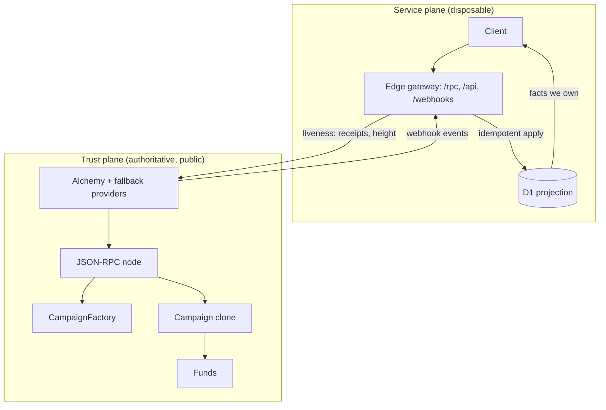

# System Architecture

Three diagrams carry this document: `system-architecture-min.png`, `campaign-lifecycle.png`,
`tx-lifecycle.png`.

## Shape of the system

Two planes, one boundary.

```
TRUST PLANE   contracts, balances, state transitions   (authoritative, slow, public)
──────────────────────── trust boundary ────────────────────────
SERVICE PLANE wallets, RPC, edge cache, file storage, UI (convenience, fast, disposable)
```

Anything in the service plane may lie, stall, or vanish. The system must remain correct and usable
when it does.

## Component responsibilities

| Component | Owns | Must never own |
|---|---|---|
| `CampaignFactory` | Campaign creation, registry, clone deployment | Funds of any campaign |
| `Campaign` (clone) | Contributions, milestone state, challenge window, veto⇒cancel, payouts, refunds | Anything outside its own campaign |
| React + Vite app | Rendering, form validation, intent display | Signing, balances, truth about state |
| Effect-TS tx machine | Transaction state and typed errors | Business rules (those live in the contract) |
| Edge gateway Worker | `/rpc`: key hiding, `eth_*` allowlist, per-IP budget. `/api`: domain reads from D1. `/webhooks/alchemy`: HMAC-verified event ingest | Keys, funds, authority over state |
| Ingest (webhook + cron reconciler) | Event delivery into the projection; INV-1 checking (`getBalance` vs projected totals) | Authority; rebuildable from genesis |
| D1 | Event projection: campaign lists, history, locality | Source of truth |
| R2 | Cover images, evidence files | Integrity (the hash lives on-chain) |
| Turnstile | Anti-spam on campaign creation | Contract-level anti-spam (it cannot be) |

## Why these technologies

| Layer | Choice | Why | Rejected |
|---|---|---|---|
| Contracts | Solidity 0.8.x, Foundry | Graded requirement; fuzz and invariant testing; gas snapshots | Hardhat (slower tests), Vyper (less tooling) |
| Chain | zkSync Sepolia primary, Ethereum Sepolia baseline | L2 is the only place the cost model works; L1 baseline gives the comparison | L1 only (cost model forbids it) |
| Frontend | React + Vite + wagmi/viem | viem is the current typed client; wagmi handles connector and chain state | Ethers.js (heavier types), vanilla JS (no state model) |
| Tx state | Effect-TS | Pending/success/failure is a typed state machine with retries and tagged errors | `useState` booleans (show "success" before a receipt) |
| Edge | Cloudflare Workers, one gateway | One trust boundary for `/rpc`, `/api`, and webhook ingest; keeps the RPC key off the client, costs nothing at this scale | Next.js server routes (needs a server), client-side RPC (leaks the key), two separate Workers (two key stores, two rate limiters) |
| Storage | R2 + D1 | Object storage with hash anchoring; event projection that is a *locality guarantee*, not a cache: reads survive any provider outage | IPFS (pinning problem), Postgres (a server for no benefit) |
| Ingest | Alchemy webhooks + Cloudflare Cron reconciler | At-least-once delivery forces an idempotent, order-tolerant consumer — the transferable event-driven lesson; the reconciler closes delivery gaps and doubles as the INV-1 checker | Go indexer (hours of websocket plumbing for the same projection) |

Hugo is a static site generator. It cannot sign transactions or hold wallet state, so it is not
the dApp frontend. It is used only for the project page that links the report, demo video, and
deployment addresses.

Exactly one file imports anything Alchemy-specific: the provider adapter, which implements a
`ChainProvider` port (`getLogs`, `getReceipt`, `simulate`, `blockNumber`). Anvil and a public RPC
implement the same port, so "which provider" is a config value and the vendor is a hidden
implementation detail, testable against Anvil.

## On-chain design

`CampaignFactory`: deploy an EIP-1167 minimal clone of one implementation, initialise it, record it.
The factory has no function that can move a campaign's funds. No owner-withdraw, no pause, no
upgrade. Deliberate. This is the security claim of the whole project.

`Campaign`: `contribute`, `deliver`, `release`, `object`, `claimRefund`, `withdraw`. `sweepDust`
was cut in Week 3: forced ETH (selfdestruct) leaves dust in the contract forever, and no path
should exist that pays it anywhere — the `Failed`/`Canceled` dust is the honest cost of an
immutable, keyless contract.

Contribution rule: contributions are capped at the goal. Money that would exceed the goal is
refused at the door, because once the campaign activates, excess has no exit; the contract never
accepts funds it cannot return.

Accounting rule: the contract's ETH balance must always equal `totalRaised - creatorWithdrawn -
refundsWithdrawn`, plus unclaimed dust. This is invariant INV-1 and it is fuzzed.

Milestone structs pack into one slot each (`uint96 amount`, `uint40 deliveredAt`, `uint96
objectionWeight`, `uint8 status` = 240 bits). Tight packing is a course pattern and saves about
20k gas per milestone.

Lifecycle:

```
Funding -> Failed                                    (deadline passed, goal missed)
Funding -> Active -> challenge window -> Released     (window expires without quorum)
                  -> Canceled                        (objection quorum reached; milestone
                                                      vetoed, all funds pull-refundable)
```

A veto never freezes funds. The quorum's power is deliberately blunt: it rejects the milestone
and cancels the campaign, and every donor withdraws their exact contribution. No key ever moves
donor funds except back to donors, so the thesis holds in the worst case, not only the happy one.
The quorum rule is fixed, not a per-campaign knob: a veto needs a majority of the money, strictly
more than half of `totalRaised` (`totalRaised / 2 + 1`). Because a single donor's weight is
capped by their contribution, no minority whale can cancel alone; the only donor who can veto
unilaterally is one who personally funded most of the campaign — and the majority funder of the
money at risk refusing to let it be spent is coherent, not griefing. The rule is derived from
`totalRaised` at veto time, so it occupies no storage and the factory interface takes no extra
parameter. The challenge window length remains the only timing knob. `docs/04-security-preview.md`
records the residual griefing trade-off.

Objection weight is contribution-weighted. Contributions are only accepted during `Funding`, so a
donor cannot buy objection weight after delivery. The attack surface is closed by the state
machine, not by a check.

Why optimistic release: per-donor approval of every milestone is the obvious mechanism and the
cost model rejected it. Design A costs $256.20 per campaign on L1, 12.81% of funds. Design B
costs $79.80, 3.99%. The difference is 69% of gas spent on confirming work donors can already
see. Optimistic release also changes the UX: a donor never signs in the happy path. Silence is
consent; dissent is a signal.

## Off-chain design

Every read belongs to one of two partitions:

- **Facts we own** — campaign history, milestone states, contribution weights, objection counts,
  evidence hashes. Derived from events, projected into D1. A *locality guarantee*, not a cache:
  they survive any provider outage.
- **Liveness we rent** — current block height, receipts for in-flight transactions, simulation.
  Ephemeral and provider-dependent, replaceable in seconds.

Read path: UI to `/api` on the gateway to D1 (projection). Events reach D1 two ways — an
Alchemy custom webhook (HMAC-verified, idempotency-keyed) and a Cloudflare Cron reconciler that
pages `eth_getLogs` from the last applied block through the same projection function. The
reconciler closes delivery gaps and doubles as the INV-1 checker: it compares `getBalance`
against projected totals and logs a violation as an event. One writer to D1 — the projection
function — so no split ownership. If D1 is empty or unavailable, the UI falls back to `/rpc`
direct reads and labels the data as slow. The fallback keeps the edge non-authoritative.

The UI never subscribes to a websocket. It polls `/api` every 2–4 s while the page is focused;
the tx machine polls `/rpc` receipts on a 2 s backoff. SSE from the gateway is a one-evening
upgrade if the course demo wants push, never a day-one subsystem.

Write path: UI to wagmi to wallet to `/rpc` to node to contract. The gateway never sees a
private key. It sees a signed transaction, forwards it, and cannot alter it. It may refuse to
forward (budget exhausted), which is a UX failure, not a correctness failure, because the user
can point at another provider.

D1 tables: `campaigns`, `contributions`, `milestones`, `objections`. Written only by the
projection function, which both the webhook and the reconciler call. Rebuild: truncate and
replay from the deployment block. The ingest is disposable by design.

## Trust boundary and degradation

| Failure | Effect | System behaviour |
|---|---|---|
| D1 down | Domain lists fail | `/api` fails closed; UI falls back to `/rpc` reads and labels data as slow |
| Webhook down or dropped | D1 serves stale rows | The reconciler replays `eth_getLogs` from the last applied block; idempotency keys make replay safe |
| Duplicate or reordered webhook | Same | Idempotent apply; order tolerance per event |
| RPC provider down | Liveness reads fail | Provider adapter fails over to the next provider; the project plan keeps a public RPC and Anvil in the list |
| Wallet rejects | No transaction | Typed `UserRejected` error, no state change, retry offered |
| Sequencer delays | Slow inclusion | `not seen` state with polling, no false success |
| Reorg | Rolled-back state | `finalized` to `stale`, data refetched |
| R2 object deleted | Evidence unavailable | Hash remains; UI shows "evidence unavailable, hash on-chain" |
| Contract bug | Permanent | No admin key, no upgrade. Tests are the only safety net |

## Deployment topology

| Environment | Chain | Frontend | Ingest | Purpose |
|---|---|---|---|---|
| Local | Anvil (chain id 31337) | Vite dev server | optional | Development, `make demo` |
| Preview | zkSync Sepolia | Cloudflare preview URL | optional | Course demo |
| Baseline | Ethereum Sepolia | Cloudflare production URL | yes | Measured gas comparison for the report |

Gas and cost results are recorded per environment in the report, with block numbers. Alchemy
zkSync Sepolia support is verified during Week 5 setup; if the network is unavailable, the
provider port points zkSync at an alternative RPC and the baseline deployment is unaffected.

## Open questions

### Week 3 interface deltas (implemented)

Implementation revealed a handful of gaps in the pinned Week 1–2 interfaces. All are additive:

- Events `CampaignActivated` and `CampaignCompleted`: the indexer needs the goal-met and
  completion transitions even when no donor or creator acts.
- `finalizeOutcome()`: permissionless materialization of the deadline outcome, so the
  `Funding → Active/Failed` event always exists to subscribe to.
- Errors `AlreadyInitialized` (clone takeover, T11), `UnknownMilestone`,
  `MilestoneAlreadyObjected` (double-count guard on objection weight), `MilestoneAlreadyReleased`,
  `TransferFailed`; factory error `InvalidChallengeWindow`.
- `initialize` remains off the donor-facing interface: it is clone plumbing, called by the
  factory through the concrete implementation type.

1. ~~Quorum by money or by voice?~~ Answered in Week 2 review: by money, and fixed at a majority.
   The veto quorum is strictly more than half of `totalRaised` (`totalRaised / 2 + 1`), derived
   from the accounting total rather than stored or configured. Voice-weighting makes a $5 donor
   equal to a $5,000 donor in deciding where *their shared money* goes; money-weighting is the
   fair rule for escrow, and the majority bar removes the whale-veto problem the veto⇒cancel rule
   would otherwise create.
2. ~~Should a disputed milestone be releasable by a supermajority of donors, or only resolvable
   off-chain?~~ Answered in Week 2 review: no. Dispute freezes had no legitimate terminal without
   on-chain arbitration, which is out of scope. A quorum now vetoes the milestone and cancels the
   campaign; all unwithdrawn funds become pull-refundable. Blunt, honest, and no stuck state.
3. Is the evidence hash enough? A hash proves the file did not change; it does not prove the file
   is true. No on-chain system fixes that without an oracle.

## Mermaid source (for Obsidian)



The line between the two subgraphs is the trust boundary. The service plane may lie, stall, or
vanish. The trust plane is the source of truth. Facts flow chain → projection → domain API;
liveness is rented from whichever provider answers.